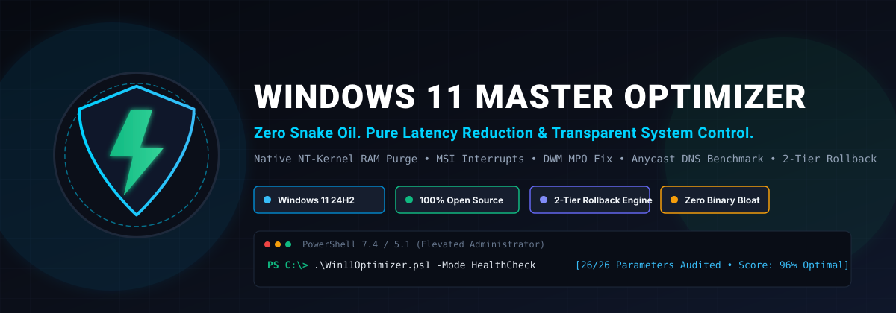
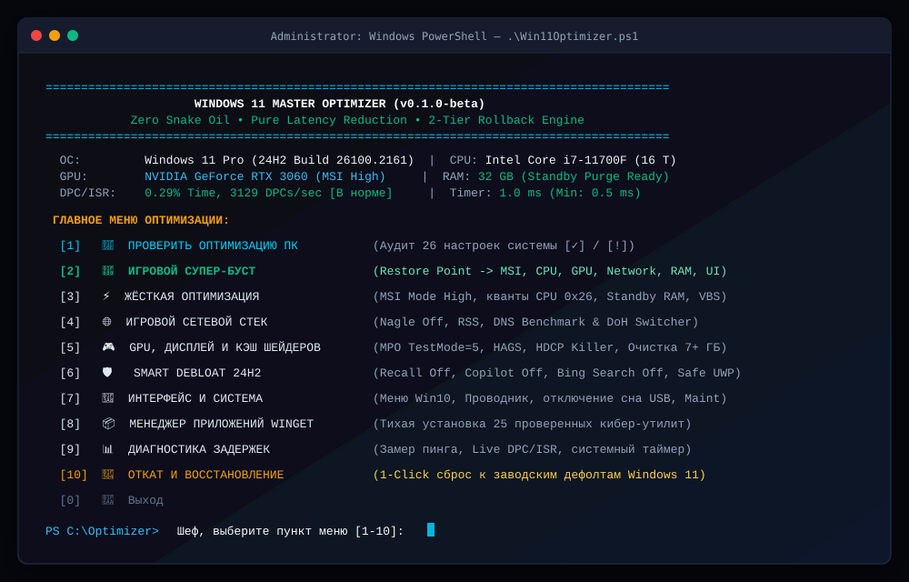
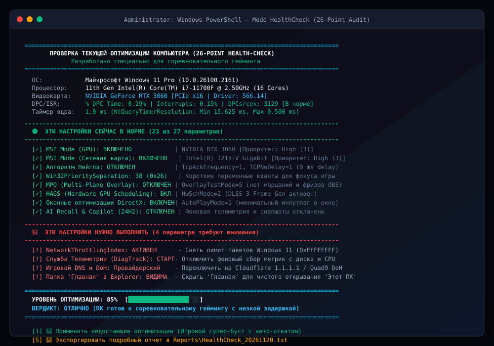
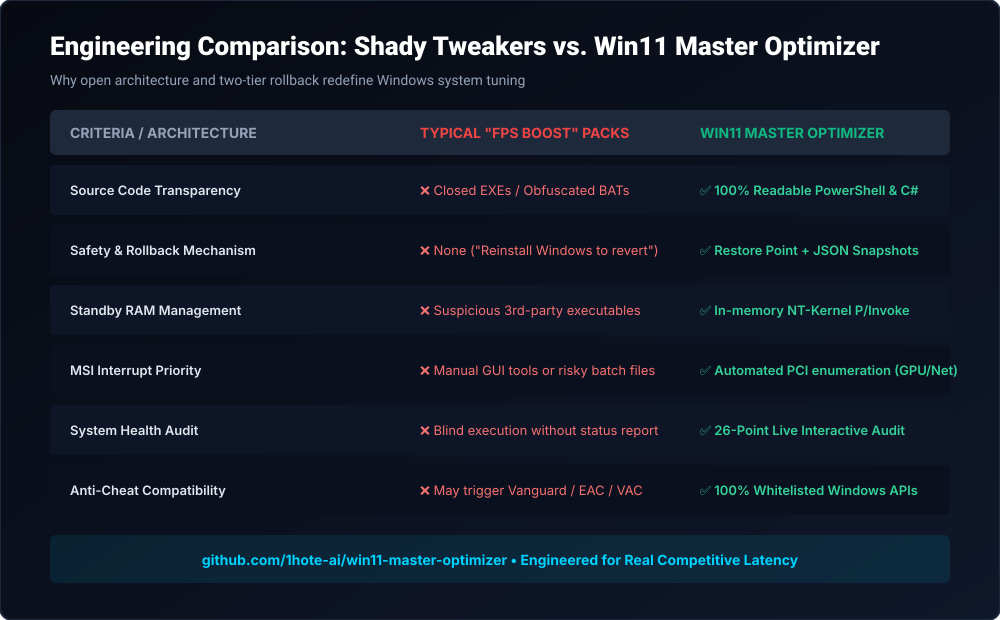

<div align="center">




# Windows 11 Master Optimizer
**Zero Snake Oil. Pure Latency Reduction & Transparent System Control.**

[-00D2FF?style=for-the-badge&logo=windows11&logoColor=white)](https://github.com/1hote-ai/win11-master-optimizer)
[](https://github.com/1hote-ai/win11-master-optimizer)
[](docs/SAFETY_AUDIT.md)
[](Test-Win11Optimizer.ps1)
[](LICENSE)

[English](README.md) • [Русский](README.ru.md) • [Documentation](docs/PRODUCT_PASSPORT.md) • [Safety Audit](docs/SAFETY_AUDIT.md) • [Topics & SEO](docs/GITHUB_TOPICS.md) • [Bug Report](https://github.com/1hote-ai/win11-master-optimizer/issues/new/choose)

</div>

---

## ⚡ Overview

**Windows 11 Master Optimizer** is an open-source, non-destructive system tuning and diagnostic suite designed specifically for competitive gamers, streamers, and power users. 

Unlike legacy "black box" tweakers and opaque batch scripts from the 2010s that blindly purge system services and trigger anti-cheat flags, this project operates on **four engineering cornerstones**:

1. **Deterministic Execution:** Every parameter modification corresponds to documented Microsoft Windows Subsystems and NT-kernel behaviors.
2. **Two-Tier Rollback Engine:** Automated creation of Windows System Restore Points combined with per-operation JSON registry snapshots. Any change can be reverted in one click.
3. **Native NT-Kernel Memory Management:** Standby RAM cleaning and high-resolution timer queries use native Win32/NT-kernel P/Invoke (`NtSetSystemInformation`, `NtQueryTimerResolution`), dropping zero closed-source binaries onto your disk.
4. **Hardware & Driver Awareness:** PCI bus introspection ensures high-priority MSI interrupts are only assigned to compatible GPU, Network, and Audio controllers without risking BSODs.

---

## 🎯 Architecture & What Makes It Different

```
win11-master-optimizer/
├── Win11Optimizer.ps1             # Main Orchestrator (TUI Menu & CLI Engine)
├── Test-Win11Optimizer.ps1        # Automated Test Suite (66 automated assertions)
├── Start.bat / Start-Optimizer.bat # Clean Elevation Launchers (UTF-8, UAC Auto-Elevation)
├── Modules/
│   ├── Safety.psm1                # System Restore Points, JSON Snapshots & Strict Allowlist
│   ├── GamingLatency.psm1         # MSI Mode, CPU Scheduling, RAM Purge, 1:1 Raw Mouse, Keyboard Tuning, Laptop Guard
│   ├── NetworkGaming.psm1         # Nagle Algorithm, RSS, TCP Stack, DNS Benchmark & DoH
│   ├── GpuDisplay.psm1            # MPO Fix, HAGS, DirectX Windowed, HDCP Killer, Cache Clean
│   ├── Debloat.psm1               # 24H2 Recall, Copilot, Bing Search, Telemetry, Safe UWP
│   ├── SystemUI.psm1              # Classic Menu, Explorer Tweaks, Gallery Hide, Game Mode, USB Power
│   ├── Diagnostics.psm1           # 31-Point Health Audit, Timer Resolution, DPC/ISR, Ping
│   └── AppInstaller.psm1          # Winget Silent Package Manager (25 curated tools)
├── Backups/                       # JSON state snapshots before modifications
└── Reports/                       # Timestamped diagnostic & audit logs
```

---

## 🖥 Interface & Real Terminal Visualizations

Windows 11 Master Optimizer provides both an interactive, dynamic Text User Interface (TUI) with real-time optimization status indicators and a non-interactive CLI mode for automated silent tuning.

<div align="center">

| 🖥️ Interactive TUI Main Menu | 🩺 26-Point System Health Audit |
| :---: | :---: |
| [](assets/marketing/screenshot-tui-main.svg) | [](assets/marketing/screenshot-health-check.svg) |

### 🎬 Animated CLI Execution Demo


</div>

---

### 🔬 Comparison with Legacy Tweakers

<div align="center">
  
</div>

| Feature / Criterion | Typical "FPS Boost" Packs | Win11 Master Optimizer |
| :--- | :--- | :--- |
| **Code Transparency** | ❌ Obfuscated BATs / Closed EXEs | ✅ 100% Auditable PowerShell & C# P/Invoke |
| **Rollback Capability** | ❌ None ("Reinstall Windows") | ✅ System Restore Points + JSON Snapshots |
| **Standby RAM Cleaner** | ❌ Unsigned 3rd-party binaries | ✅ In-memory NT-Kernel `NtSetSystemInformation` |
| **Interrupt Management** | ❌ Manual or dangerous generic tools | ✅ Safe PCI Bus filter (`Display`, `Net`, `Media`) |
| **Windows 11 24H2** | ❌ Broken by Windows 11 updates | ✅ Tested & optimized for 24H2 (Build 26100+) |
| **Anti-Cheat Safe** | ❌ Flagged by Vanguard/EAC/VAC | ✅ 100% Standard Windows Management APIs |

---

## 🛠 Feature Modules

### 1. ⚡ Gaming Latency & Memory (`GamingLatency.psm1`)
- **Native NT-Kernel Standby RAM Cleaner:** Obtains `SeProfileSingleProcessPrivilege` and calls `NtSetSystemInformation(80, ref 4)` to purge the cached Standby list and trim idle working sets. Fixes allocation hitching in memory-intensive titles (Escape from Tarkov, Rust, Battlefield) without third-party utilities.
- **Automated MSI Mode (Message Signaled Interrupts):** Scans the PCI bus and migrates GPU, Network, and Audio controllers to MSI mode with High Priority (`DevicePriority = 3`). Eliminates shared IRQ bottlenecks and minimizes DPC latency queues.
- **CPU Scheduling Quantum Tuning:** Configures `Win32PrioritySeparation = 38 (0x26)` for short, variable quantum bursts favoring foreground games, accompanied by `PowerThrottlingOff = 1`.
- **SystemResponsiveness = 0:** Removes Windows 20% background multimedia scheduling reserve, allocating 100% CPU time to the active process.
- **Core Parking & Energy Performance:** Unparks all CPU cores (`CPMINCORES = 100`) and forces `PERFEPP = 0` for constant peak frequency responsiveness.
- **VBS / HVCI Security Toggle:** Optional opt-in toggle to disable Hypervisor-Enforced Code Integrity for older CPUs, with clear security tradeoff warnings.

### 2. 🎮 GPU, Display & Shader Cache (`GpuDisplay.psm1`)
- **DWM Multi-Plane Overlay (MPO) Toggle:** Sets `OverlayTestMode = 5` in DWM. Completely eliminates display flicker, black screens, and micro-stutters when running borderless games alongside Discord, OBS, or Chrome.
- **HAGS (Hardware-Accelerated GPU Scheduling):** Toggles `HwSchMode = 2`, required for DLSS 3 / FSR 3 frame generation and reduced input-to-display latency.
- **DirectX Borderless Window Optimization:** Enables `AutoPlayMode = 1;` in `UserGpuPreferences` for low latency and Variable Refresh Rate (VRR / G-Sync) support in borderless windows.
- **GPU Driver Protection:** Blocks Windows Update from overwriting your custom graphics driver (`ExcludeWUDriversInQualityUpdate = 1`).
- **NVIDIA HDCP DRM Bypass:** Searches for NVIDIA cards and disables HDCP handshake overhead (`RMHdcpKeyglobZero = 1`) to reduce D3D rendering micro-delays.
- **Shader Cache & Temp Purge (7+ GB):** Cleans corrupt and obsolete shader compilations across NVIDIA DXCache/GLCache, Direct3D D3DSCache, AMD DxCache, and Windows Temp.

### 3. 🌐 Competitive Network Stack & DNS Switcher (`NetworkGaming.psm1`)
- **Anycast Gaming DNS Benchmark:** Live latency measurement (Query Latency + ICMP Ping) against Cloudflare (`1.1.1.1`), Quad9 (`9.9.9.9`), Google (`8.8.8.8`), and AdGuard (`94.140.14.14`).
- **1-Click DoH Switcher:** Applies selected DNS with automatic DNS-over-HTTPS (DoH) encryption registration.
- **Nagle's Algorithm Disable:** Injects `TcpAckFrequency = 1`, `TCPNoDelay = 1`, and `TcpDelAckTicks = 0` on active network adapters for immediate packet dispatch without queuing delays.
- **Global TCP Stack Optimization:** Enables Receive Side Scaling (RSS) across multi-core CPUs, normalizes TCP Window Auto-Tuning, disables unnecessary TCP timestamps, and disables ECN.
- **NIC Power-Saving Disable:** Automatically disables Energy Efficient Ethernet (EEE), Green Ethernet, and Ultra Low Power modes to prevent packet drops.

### 4. 🛡 Modern Debloat (Windows 11 24H2 Ready) (`Debloat.psm1`)
- **Disable Windows 11 AI Recall (24H2):** Enforces `DisableAIDataAnalysis = 1` and disables the DISM Optional Feature.
- **Disable Microsoft Copilot:** Removes the taskbar button and enforces `TurnOffWindowsCopilot = 1`.
- **Disable Bing Search in Start Menu:** Restricts Start Menu search strictly to local files.
- **Disable Widgets & News Feed:** Cleans taskbar bloat and stops background MSN Web Experience processes.
- **Disable Telemetry & Diagnostics:** Disables `DiagTrack` (Connected User Experiences) and `dmwappushservice`.
- **Safe UWP Removal with Strict Whitelist:** Uninstalls bloatware while strictly preserving Microsoft Store, Xbox, Calculator, Notepad, Paint, Snipping Tool, Terminal, and Windows Security.

### 5. 🎨 System UI & Workflow (`SystemUI.psm1`)
- **Classic Context Menu:** Reinstates the fast Windows 10 right-click menu via CLSID `{86ca1aa0-34aa-4e8b-a509-50c905bae2a2}` without "Show more options".
- **Clean Explorer View:** Shows file extensions, enables compact view, opens to "This PC", and removes search highlights.
- **Disable Automatic Maintenance:** Stops background defragmentation and scans during active gameplay.
- **USB Power Saving Disable:** Prevents high-polling mice (1000–8000 Hz) and keyboards from dropping connection.

### 6. 📊 Diagnostics & Latency Audit (`Diagnostics.psm1`)
- **31-Point Comprehensive Health Audit:** Real-time system check classifying settings into `[✓] Optimal` and `[!] Action Required` with exact fix recommendations.
- **Native Win32 Timer Resolution:** Real-time query of system timer tick frequency (`NtQueryTimerResolution`).
- **Live DPC / ISR Counter:** Real-time sampling of DPC time and interrupt queue frequency.

### 7. 📦 Silent App Installer (`AppInstaller.psm1`)
- Native `winget` wrapper for 25 curated gaming essentials (CapFrameX, HWiNFO64, Process Lasso, FanControl, LatencyMon, Steam, Discord, OBS Studio, Visual C++ Runtimes).

---

## ⚡ 3-Tier Preset Architecture

The suite features three tailored optimization tiers designed for specific use cases:

1. **🛡️ Tier 1: Light (Surface / Office & Safe):**
   - **Focus:** Privacy, clean UI, zero breakage of office or peripheral hardware.
   - **Actions:** Telemetry & background tracking disabled (DiagTrack, dmwappushservice), Bing search in Start menu disabled, Copilot disabled, Widgets feed disabled, Recall disabled, File Explorer cleanups (extensions visible, compact mode, open This PC, recommendations hidden).
   - **Strictly Preserved:** Print Spooler (`Spooler`), Bluetooth (`bthserv`), Network Sharing / Discovery, Windows Update, BITS, and standard balanced power profile / USB power savings (safe for office PCs and battery life).

2. **⚖️ Tier 2: Balanced (Medium / Daily Driver & Gaming):**
   - **Focus:** Smooth gaming and system cleanup safe for daily drivers and laptops.
   - **Actions:** All tweaks in Light + GameDVR background recording disabled, FSE enabled, Game Mode forced on, DirectX Windowed optimizations (`AutoPlayMode=1;`), Network RSS enabled, TCP Window Auto-Tuning normal, safe UWP debloat (strict whitelist preserving Store, Xbox, Calc, Notepad, Paint, Security), shader cache and Temp cleanup.
   - **Preserved:** No aggressive hardware priority modifications or battery-draining power schemes.

3. **⚡ Tier 3: Ultra Gaming (Esports / Maximum):**
   - **Focus:** Extreme input latency reduction (DPC/ISR queue mitigation, 1% low frametime smoothing) for competitive gaming rigs.
   - **Actions:** All tweaks in Balanced + MSI Mode (High Priority for GPU, NIC, Sound), CPU scheduling quantum 38 (`0x26`), Power Throttling disabled, Standby RAM purge (`NtSetSystemInformation`), Ultimate Performance power plan with **Laptop Guard** (WMI battery detection preventing DC battery drain), HAGS enabled, MPO disabled (`OverlayTestMode=5`), GPU driver update protection, NVIDIA HDCP DRM killer, full Nagle's algorithm killer on all adapters, USB power saving disabled, 1:1 Raw Mouse Input (`MouseSpeed=0, Threshold=0`), Keyboard Response Tuning (`Delay=0, Speed=31`), and File Explorer Gallery node removal (`ThisPCPolicy=Hide`).

---

## 🚀 Installation & Launch

### System Requirements
- **OS:** Windows 11 (22H2, 23H2, 24H2 Build 26100+)
- **PowerShell:** 5.1 (Built into Windows) or PowerShell 7.2+
- **Privileges:** Administrator privileges (Elevated UAC token)

### Option 1: Git Clone (Recommended)
```powershell
git clone https://github.com/1hote-ai/win11-master-optimizer.git
cd win11-master-optimizer
```
Double-click `Start.bat` (or `Start-Optimizer.bat`), or run in PowerShell:
```powershell
powershell -ExecutionPolicy Bypass -File .\Win11Optimizer.ps1
```

### Option 2: CLI Automation Modes
Run specific tasks without entering the interactive menu:

```powershell
# Tier 3: Ultra Gaming esports preset (MSI, CPU Quantum 38, MPO, HAGS, Nagle, Raw Input)
powershell -ExecutionPolicy Bypass -File .\Win11Optimizer.ps1 -Mode UltraGaming

# Tier 2: Balanced preset (Safe for laptops & daily drivers)
powershell -ExecutionPolicy Bypass -File .\Win11Optimizer.ps1 -Mode Balanced

# Tier 1: Light preset (Privacy, Clean UI, peripheral safe)
powershell -ExecutionPolicy Bypass -File .\Win11Optimizer.ps1 -Mode Light

# Backward compatible alias to UltraGaming
powershell -ExecutionPolicy Bypass -File .\Win11Optimizer.ps1 -Mode AutoGaming

# Dry-Run mode: Preview all planned changes without touching the system
powershell -ExecutionPolicy Bypass -File .\Win11Optimizer.ps1 -Mode UltraGaming -DryRun

# Run the 31-point System Health Audit
powershell -ExecutionPolicy Bypass -File .\Win11Optimizer.ps1 -Mode HealthCheck

# In-memory NT-Kernel Standby RAM purge
powershell -ExecutionPolicy Bypass -File .\Win11Optimizer.ps1 -Mode RamClean

# Benchmark gaming DNS servers
powershell -ExecutionPolicy Bypass -File .\Win11Optimizer.ps1 -Mode DnsBenchmark

# Apply GPU & Display tweaks only (MPO, HAGS, DirectX)
powershell -ExecutionPolicy Bypass -File .\Win11Optimizer.ps1 -Mode GpuOnly

# Launch the Rollback Master
powershell -ExecutionPolicy Bypass -File .\Win11Optimizer.ps1 -Mode Rollback
```

---

## 🔄 Two-Tier Rollback & Safety Engine

Your system's stability is our highest priority:

1. **Tier 1 — Windows System Restore Point:**  
   Before applying presets, the optimizer automatically creates a named System Restore Point (`Checkpoint-Computer`), overriding the 24-hour Windows throttle.
2. **Tier 2 — Granular JSON Registry Snapshots:**  
   Before any registry key is modified, its exact path, name, existence state, and type are saved to `Backups/Backup_<Category>_<Timestamp>.json`.
3. **1-Click Rollback:**  
   Select `[11] ОТКАТ И ВОССТАНОВЛЕНИЕ` in the main menu to revert specific modules or restore all parameters back to official Microsoft Windows 11 factory defaults.

---

## 🧪 Verification & Automated Testing

This repository includes an automated test suite with 66 assertions verifying module loading, snapshot creation, granular rollback integrity, hardware enumeration, and dry-run execution:

```powershell
powershell -ExecutionPolicy Bypass -File .\Test-Win11Optimizer.ps1
```

```
========================================================
     RUNNING WIN11 OPTIMIZER SMOKE & INTEGRITY TESTS    
========================================================
  Testing [Module: Safety.psm1 loads]... [PASS]
  Testing [Safety: Snapshot & Rollback integrity test]... [PASS]
  Testing [Hardware: GPU, Network and Sound cards detected]... [PASS]
  Testing [RAM Cleaner: SeProfileSingleProcessPrivilege helper]... [PASS]
  Testing [Diagnostics: Comprehensive optimization audit (31 settings)]... [PASS]
  Testing [Preset: Light preset dry-run completes without error]... [PASS]
  Testing [Preset: Balanced preset dry-run completes without error]... [PASS]
  Testing [Preset: UltraGaming preset dry-run completes without error]... [PASS]
  Testing [GamingLatency: Live Mouse and Keyboard Rollback with Win32 SPI synchronization]... [PASS]
  Testing [GamingLatency: Laptop Guard battery detection and DC power profile adaptation]... [PASS]
  Testing [SystemUI: Explorer Gallery Status handles HKCU policy and Restore-ExplorerGalleryVisibility NoRestart]... [PASS]
========================================================
  TEST RESULTS: Passed: 66 | Failed: 0
========================================================
```

---

## ❓ Frequently Asked Questions (FAQ)

<details>
<summary><b>Does this tool increase my average FPS by 100%?</b></summary>

**No.** Any tweaker claiming massive average FPS increases on modern GPUs is selling snake oil. What this suite achieves is **frametime consistency**: it eliminates DPC interrupt latency spikes, resolves MPO stutter in borderless gaming, frees standby RAM allocation hitches, and optimizes CPU scheduling. The result is significantly better 1% and 0.1% low frametimes and reduced input delay.
</details>

<details>
<summary><b>Will this break Windows Update or Microsoft Store?</b></summary>

**No.** The debloat module strictly preserves Microsoft Store, Xbox app, Calculator, Notepad, Snipping Tool, and Windows Security (`SecHealthUI`). Windows Update remains fully functional; the only modification is preventing Windows Update from overwriting your custom GPU display drivers.
</details>

<details>
<summary><b>Is it safe for Vanguard, Easy Anti-Cheat (EAC), and BattlEye?</b></summary>

**Yes.** We do not patch game binaries, hook system DLLs, or inject runtime drivers. All optimizations use official Windows registry keys, PowerShell APIs, and documented NT-kernel system information calls.
</details>

<details>
<summary><b>How do I completely undo everything?</b></summary>

Launch `Win11Optimizer.ps1 -Mode Rollback` and select option `[8] Full Rollback to Windows Defaults`. It reads your original JSON snapshots, validates each entry independently, and resets all modified keys and network stacks back to standard Windows defaults.
</details>

---

## 🗺 Roadmap

- [x] Windows 11 24H2 full compatibility
- [x] NT-Kernel in-memory Standby RAM Cleaner
- [x] Granular 2-Tier Snapshot & Rollback Engine with per-parameter tracking
- [x] Automated 66-assertion Smoke & Integrity Test Suite
- [x] 3-Tier Preset Architecture (Light, Balanced, Ultra Gaming) with Laptop Guard
- [x] Anycast DNS Benchmark & DoH Switcher
- [ ] Exportable HTML/JSON Health Audit Reports
- [ ] Automated LatencyMon integration for pre/post DPC telemetry
- [ ] Micro-benchmark recording tool for 1% Low frametimes
- [ ] Community-voted custom game presets (CS2, Valorant, Apex Legends)

---

## 🤝 Contributing

We welcome contributions from developers, testers, and system enthusiasts! Please read [CONTRIBUTING.md](CONTRIBUTING.md) and our [SECURITY.md](SECURITY.md) guidelines before submitting a Pull Request.

---

## ⚖ License

This project is licensed under the **MIT License** — see the [LICENSE](LICENSE) file for details.  
Copyright (c) 2026 1hote-ai.
