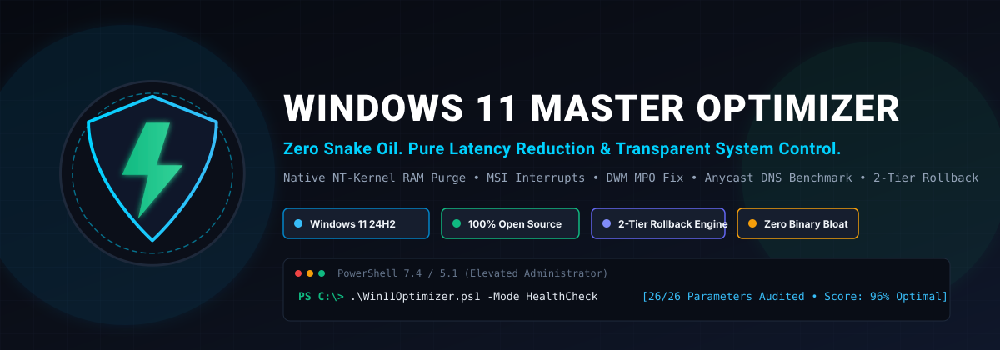
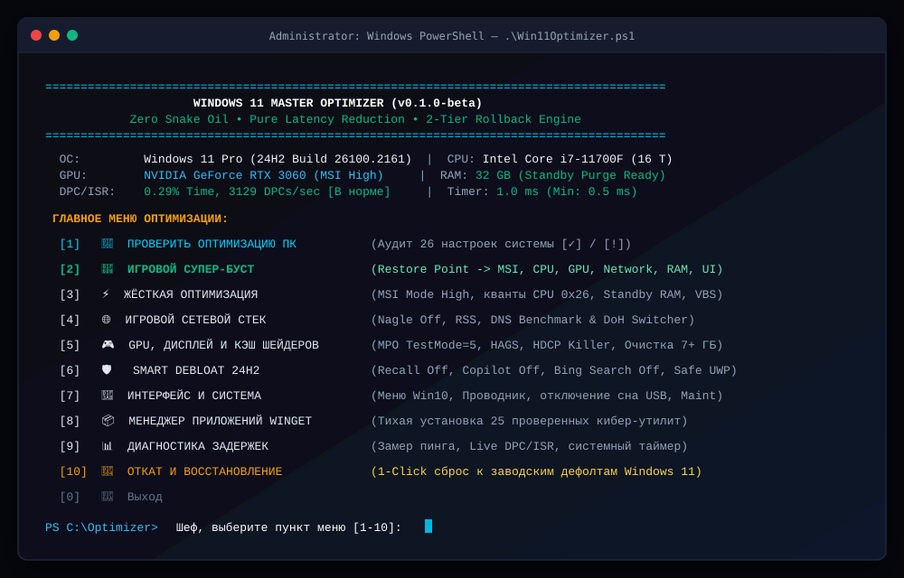
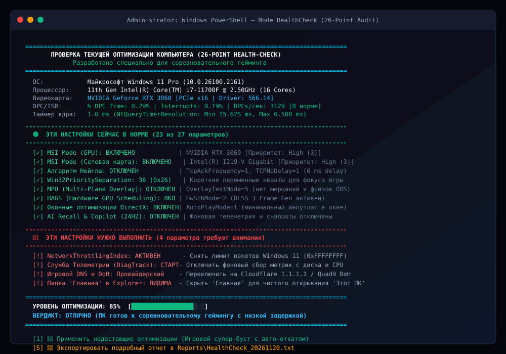
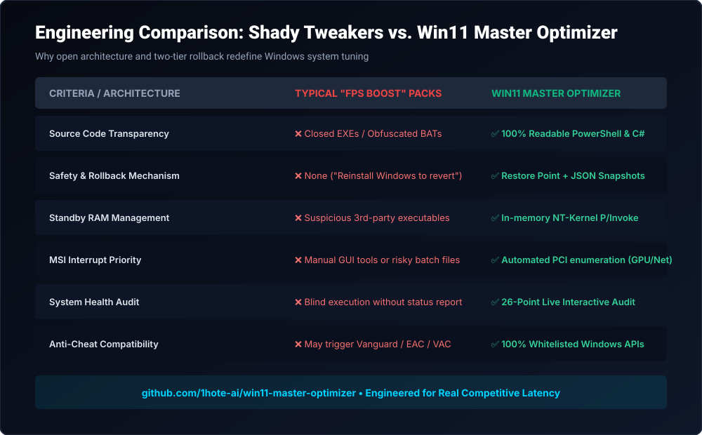

<div align="center">




# Windows 11 Master Optimizer
**Честная оптимизация задержек Windows 11. Без плацебо, с полным контролем и откатом.**

[-00D2FF?style=for-the-badge&logo=windows11&logoColor=white)](https://github.com/1hote-ai/win11-master-optimizer)
[](https://github.com/1hote-ai/win11-master-optimizer)
[](docs/SAFETY_AUDIT.md)
[](Test-Win11Optimizer.ps1)
[](LICENSE)

[English](README.md) • [Русский](README.ru.md) • [Паспорт Продукта](docs/PRODUCT_PASSPORT.md) • [Аудит Безопасности](docs/SAFETY_AUDIT.md) • [GitHub Topics & SEO](docs/GITHUB_TOPICS.md) • [Сообщить об ошибке](https://github.com/1hote-ai/win11-master-optimizer/issues/new/choose)

</div>

---

## ⚡ Обзор проекта

**Windows 11 Master Optimizer** — это модульный, прозрачный и полностью реверсивный комплекс оптимизации Windows 11, созданный специально для соревновательных геймеров, стримеров и требовательных пользователей.

В отличие от сомнительных твикеров из 2010-х годов и закрытых `.bat` файлов, которые вслепую вырезают системные службы и ловят баны в античитах, наш проект построен на **четырех инженерных принципах**:

1. **Детерминированность:** Каждая настройка привязана к документированным подсистемам Windows и поведению NT-ядра.
2. **Двухуровневый откат (Rollback Engine):** Автоматическое создание официальных точек восстановления Windows вместе с покатегорийными JSON-снимками ключей реестра. Любое изменение можно вернуть в 1 клик.
3. **Очистка памяти через NT-ядро:** Очистка Standby RAM кэша и замер таймера через нативный C# P/Invoke (`NtSetSystemInformation`, `NtQueryTimerResolution`) прямо из оперативной памяти без посторонних исполняемых файлов.
4. **Безопасность оборудования:** Сканирование шины PCI для безопасного включения высокоприоритетных прерываний MSI Mode только для совместимых видеокарт, сетевых и аудио адаптеров.

---

## 🎯 Архитектура проекта

```
win11-master-optimizer/
├── Win11Optimizer.ps1             # Главный движок (TUI-меню и CLI-режимы)
├── Test-Win11Optimizer.ps1        # Автоматический тестовый набор (63 проверки)
├── Start.bat / Start-Optimizer.bat # Надежные лаунчеры с авто-UAC (UTF-8)
├── Modules/
│   ├── Safety.psm1                # Точки восстановления, JSON-снимки и строгий allowlist
│   ├── GamingLatency.psm1         # MSI Mode, кванты CPU, очистка RAM, 1:1 Raw Mouse, отклик клавиатуры, Laptop Guard
│   ├── NetworkGaming.psm1         # Алгоритм Нейгла, RSS, TCP стек, DNS Benchmark и DoH
│   ├── GpuDisplay.psm1            # Отключение MPO, HAGS, DirectX, HDCP Killer, очистка кэша
│   ├── Debloat.psm1               # Отключение Recall 24H2, Copilot, Bing, телеметрии, Safe UWP
│   ├── SystemUI.psm1              # Классическое меню, Проводник, скрытие Галереи, Game Mode, USB Power
│   ├── Diagnostics.psm1           # Аудит 31 настройки, Win32 таймер, замер DPC/ISR, пинг
│   └── AppInstaller.psm1          # Тихий установщик Winget (25 проверенных программ)
├── Backups/                       # JSON-снимки реестра перед каждым изменением
└── Reports/                       # Сохраненные отчеты диагностики и аудита
```

---

## 🖥 Интерфейс и живая демонстрация работы

Windows 11 Master Optimizer оснащен как интерактивным терминальным меню (TUI) с живыми динамическими индикаторами статуса параметров, так и фоновым CLI-интерфейсом для быстрой автоматизации.

<div align="center">

| 🖥️ Главное интерактивное TUI-меню | 🩺 Аудит 26 параметров системы (Health-Check) |
| :---: | :---: |
| [](assets/marketing/screenshot-tui-main.svg) | [](assets/marketing/screenshot-health-check.svg) |

### 🎬 Анимированная демонстрация работы CLI


</div>

---

### 🔬 Сравнение с типичными твикерами

<div align="center">
  
</div>

| Возможность / Критерий | Обычные "FPS Boost" паки | Win11 Master Optimizer |
| :--- | :--- | :--- |
| **Прозрачность исходного кода** | ❌ Закрытые EXE / мутные BAT | ✅ 100% Открытый PowerShell и C# P/Invoke |
| **Гарантия и откат изменений** | ❌ Отсутствует («Переустанови винду») | ✅ Точки восстановления + JSON-снимки реестра |
| **Очистка Standby RAM кэша** | ❌ Неподписанные сторонние утилиты | ✅ Прямой вызов `NtSetSystemInformation` в RAM |
| **Управление прерываниями (MSI)**| ❌ Вслепую или вручную через чужой софт | ✅ Безопасный PCI-фильтр (`Display`, `Net`, `Media`) |
| **Поддержка Windows 11 24H2** | ❌ Ломается обновлениями Windows | ✅ Полная адаптация под 24H2 (Build 26100+) |
| **Безопасность для античитов** | ❌ Риск бана в Vanguard/EAC/VAC | ✅ Только штатные системные API Windows |

---

### 1. ⚡ Жёсткая оптимизация задержек и Standby RAM (`GamingLatency.psm1`)
- **Очистка Standby RAM кэша NT-ядром:** Получает привилегию `SeProfileSingleProcessPrivilege` и вызывает функцию `NtSetSystemInformation(80, ref 4)`. Освобождает занятую кэшем оперативную память без сторонних утилит, устраняя микрофризы в играх с интенсивным выделением памяти (Escape from Tarkov, Rust, Battlefield).
- **Автоматический MSI Mode (Message Signaled Interrupts):** Сканирует шину PCI и переводит видеокарту, сетевой адаптер и звуковой контроллер в MSI-режим с наивысшим приоритетом прерываний (`DevicePriority = 3`). Устраняет узкие места очередей DPC/ISR.
- **Кванты планировщика CPU:** Устанавливает `Win32PrioritySeparation = 38 (0x26)` (короткие переменные кванты с 3-кратным приоритетом активного игрового окна) и отключает Power Throttling (`PowerThrottlingOff = 1`).
- **SystemResponsiveness = 0:** Снимает 20% системную бронь Windows на фоновые мультимедиа-задачи, отдавая 100% мощности процессора игре.
- **Core Parking Off:** Разблокирует 100% ядер процессора (`CPMINCORES = 100`) и выставляет `PERFEPP = 0`.
- **Тумблер VBS / HVCI:** Опциональная возможность отключения изоляции ядра для слабых или старых CPU с честным предупреждением о балансе безопасности и FPS.

### 2. 🎮 GPU, Дисплей и Кэш шейдеров (`GpuDisplay.psm1`)
- **Тумблер MPO (Multi-Plane Overlay):** Установка `OverlayTestMode = 5` в DWM. Полностью устраняет мерцания, черные экраны и микро-статтеры при одновременной работе игр с Discord, OBS Studio и браузерами.
- **HAGS (Hardware-Accelerated GPU Scheduling):** Включение аппаратного планировщика GPU (`HwSchMode = 2`), необходимого для генерации кадров DLSS 3 / FSR 3 и снижения задержки рендеринга.
- **Оптимизации оконных игр DirectX:** Включение `DirectXUserGlobalSettings = "AutoPlayMode=1;"` для поддержки переменной частоты обновления (VRR / G-Sync) и минимальной задержки в borderless режиме.
- **Защита видеодрайвера от Windows Update:** Блокировка автоматической перезаписи кастомных стабильных драйверов GPU (`ExcludeWUDriversInQualityUpdate = 1`).
- **NVIDIA HDCP DRM Killer:** Поиск видеокарт NVIDIA и отключение DRM рукопожатий HDCP (`RMHdcpKeyglobZero = 1`) для устранения микро-задержек D3D.
- **Очистка кэша шейдеров и Temp (7+ ГБ):** Безопасное удаление устаревших и битых файлов компиляции шейдеров (`NVIDIA DXCache/GLCache`, `Direct3D D3DSCache`, `AMD DxCache`, `TEMP`, `SoftwareDistribution\Download`).

### 3. 🌐 Сетевой стек и DNS Switcher (`NetworkGaming.psm1`)
- **Gaming DNS Benchmark:** Живое тестирование времени отклика (Query Latency + ICMP Ping) к ведущим провайдерам Anycast DNS (Cloudflare, Quad9, Google, AdGuard).
- **1-Click DoH Switcher:** Применение DNS с автоматической регистрацией и включением шифрования DNS-over-HTTPS в Windows 11.
- **Отключение алгоритма Нейгла:** Установка `TcpAckFrequency = 1`, `TCPNoDelay = 1`, `TcpDelAckTicks = 0` на активных адаптерах для мгновенной отправки пакетов без накопления буфера.
- **Оптимизация глобального стека TCP:** Включение Receive Side Scaling (RSS), оптимизация TCP Window Auto-Tuning, отключение временных меток TCP и ECN.
- **Отключение спящих режимов сетевой карты:** Автоматическое отключение Energy Efficient Ethernet (EEE), Green Ethernet и Ultra Low Power.

### 4. 🛡 Smart Modern Debloat (Windows 11 24H2) (`Debloat.psm1`)
- **Отключение AI Recall (24H2):** Блокировка фонового анализа активности (`DisableAIDataAnalysis = 1`) и отключение системного компонента DISM.
- **Отключение Microsoft Copilot:** Полное скрытие кнопки и отключение процессов Windows Copilot через групповые политики.
- **Отключение Bing Search в меню Пуск:** Поиск находит только локальные файлы на диске.
- **Отключение виджетов и ленты новостей:** Освобождение оперативной памяти от фоновых веб-процессов MSN.
- **Блокировка телеметрии:** Остановка и отключение служб `DiagTrack` и `dmwappushservice`.
- **Безопасное удаление UWP Bloatware:** Жесткое сохранение Microsoft Store, Xbox, Калькулятора, Блокнота, Ножниц, Терминала и Защитника Windows.

### 5. 🎨 Интерфейс и система (`SystemUI.psm1`)
- **Классическое контекстное меню Windows 10:** Возврат быстрого меню без кнопки *"Показать дополнительные параметры"* через CLSID `{86ca1aa0-34aa-4e8b-a509-50c905bae2a2}`.
- **Оптимизация Проводника:** Отображение расширений файлов, скрытых папок, компактный режим, открытие *"Этот компьютер"*, скрытие блока "Рекомендуем" и спама в поиске.
- **Отключение автоматического обслуживания Windows:** Блокировка дефрагментации диска во время соревновательных игр.
- **Отключение энергосбережения USB:** Защита от микродропов мышек с высокой частотой опроса (1000–8000 Гц).

### 6. 📊 Диагностика и аудит (`Diagnostics.psm1`)
- **Аудит 26 параметров системы:** Разделение на 🟢 **ЭТИ НАСТРОЙКИ В НОРМЕ** и 🔴 **ЭТИ НАСТРОЙКИ НУЖНО ВЫПОЛНИТЬ** с точными подсказками.
- **Win32 Timer Resolution:** Замер реальной частоты прерываний таймера Windows через `NtQueryTimerResolution`.
- **Мониторинг DPC / ISR:** Замер процента времени DPC и частоты прерываний в реальном времени.

### 7. 📦 Менеджер пакетов (`winget`) (`AppInstaller.psm1`)
- Автоматическая тихая установка проверенных утилит (CapFrameX, HWiNFO64, Process Lasso, FanControl, LatencyMon, Steam, Discord, OBS Studio, C++ Runtimes).

---

## ⚡ 3-Уровневая Архитектура Пресетов

В оптимизатор встроена гибкая система из 3 специализированных профилей оптимизации:

1. **🛡️ Пресет 1: Light (Поверхностная / Офис & Безопасный):**
   - **Фокус:** Конфиденциальность, чистый интерфейс, полная гарантия сохранности периферии и офисных служб.
   - **Действия:** Отключение телеметрии и фонового трекинга (DiagTrack, dmwappushservice), поиск Bing в Пуске отключен, Copilot отключен, виджеты/лента новостей отключены, Recall отключен, оптимизация Проводника (расширения файлов, компактный вид, открытие 'Этот компьютер', скрытие рекомендаций).
   - **Строго Сохранено:** Диспетчер печати (`Spooler`), Bluetooth (`bthserv`), сетевое окружение и общий доступ, Windows Update, BITS и стандартный профиль питания USB (полная безопасность для офисных ПК и ноутбуков).

2. **⚖️ Пресет 2: Balanced (Средняя / Домашняя):**
   - **Фокус:** Плавный гейминг и очистка мусора, безопасная для повседневных ПК и ноутбуков.
   - **Действия:** Все твики из Light + отключение фоновой записи GameDVR, активация честного режима FSE, принудительный Game Mode, оптимизация оконных игр DirectX (`AutoPlayMode=1;`), включение RSS (Receive Side Scaling), TCP Window Auto-Tuning normal, безопасный UWP Debloat (строгий вайтлист Store, Xbox, Calc, Notepad, Paint, Security), очистка кэша шейдеров DirectX/OpenGL и временных файлов.
   - **Сохранено:** Без экстремальных приоритетов прерываний и без схем питания, разряжающих батарею ноутбука.

3. **⚡ Пресет 3: Ultra Gaming (Киберспорт / Максимум):**
   - **Фокус:** Экстремальное снижение инпут-лага, минимизация задержек DPC/ISR и сглаживание 1% low FPS для киберспорта.
   - **Действия:** Все твики из Balanced + MSI Mode (High Priority для GPU, Сети и Звука), квантование CPU 38 (`0x26`), отключение Power Throttling, очистка Standby RAM кэша через вызов ядра NT (`NtSetSystemInformation`), схема питания Ultimate Performance с интеллектуальной защитой **Laptop Guard** (определение батареи через WMI с сохранением энергосбережения на DC), включение HAGS, отключение MPO (`OverlayTestMode=5`), блокировка автозамены видеодрайвера, уничтожение HDCP DRM NVIDIA, отключение алгоритма Нейгла на всех адаптерах, отключение спящего режима USB, 1:1 Raw Mouse Input (`MouseSpeed=0, Threshold=0`), отклик клавиатуры (`KeyboardDelay=0, Speed=31`) и скрытие тяжелого узла Галереи Проводника (`ThisPCPolicy=Hide`).

---

## 🎮 Как запускать

### Системные требования
- **ОС:** Windows 11 (22H2, 23H2, 24H2 Build 26100+)
- **PowerShell:** 5.1 (встроен в Windows) или PowerShell 7.2+
- **Права:** Администратор (UAC токен)

### Вариант 1: Запуск через лаунчер
Дважды щелкните на `Start.bat` (или `Запустить Оптимизатор.bat`).

### Вариант 2: Запуск из консоли PowerShell (CLI Режимы)
```powershell
# Киберспортивный пресет Ultra Gaming (MSI, кванты 38, MPO, HAGS, Нейгл, 1:1 Raw Input)
powershell -ExecutionPolicy Bypass -File .\Win11Optimizer.ps1 -Mode UltraGaming

# Сбалансированный пресет Balanced (Безопасно для ноутбуков и домашних ПК)
powershell -ExecutionPolicy Bypass -File .\Win11Optimizer.ps1 -Mode Balanced

# Легкий пресет Light (Приватность, чистый UI, zero-breakage периферии)
powershell -ExecutionPolicy Bypass -File .\Win11Optimizer.ps1 -Mode Light

# Обратно-совместимый алиас к UltraGaming
powershell -ExecutionPolicy Bypass -File .\Win11Optimizer.ps1 -Mode AutoGaming

# Режим Dry-Run: предварительный просмотр действий без внесения изменений
powershell -ExecutionPolicy Bypass -File .\Win11Optimizer.ps1 -Mode UltraGaming -DryRun

# Запуск аудита системы (31 параметр)
powershell -ExecutionPolicy Bypass -File .\Win11Optimizer.ps1 -Mode HealthCheck

# Быстрая очистка Standby RAM кэша через NT-ядро
powershell -ExecutionPolicy Bypass -File .\Win11Optimizer.ps1 -Mode RamClean

# Замер задержек игровых DNS серверов
powershell -ExecutionPolicy Bypass -File .\Win11Optimizer.ps1 -Mode DnsBenchmark

# Применение только твиков GPU и дисплея (MPO, HAGS, DirectX)
powershell -ExecutionPolicy Bypass -File .\Win11Optimizer.ps1 -Mode GpuOnly

# Открытие мастера отката
powershell -ExecutionPolicy Bypass -File .\Win11Optimizer.ps1 -Mode Rollback
```

---

## 🔄 Двухуровневый откат (Rollback Engine)

1. **Уровень 1 — Точка восстановления Windows:** Перед применением комплексных пресетов автоматически создается точка восстановления `Checkpoint-Computer` с обходом 24-часового лимита Windows.
2. **Уровень 2 — Покатегорийные JSON-снимки:** До любого изменения ключей реестра создается снимок в `Backups/Backup_<Категория>_<Дата>.json`.
3. **Откат в 1 клик:** В меню выберите пункт `[11] ОТКАТ И ВОССТАНОВЛЕНИЕ`, либо запустите `Win11Optimizer.ps1 -Mode Rollback` и выберите пункт `[8] Полный сброс к заводским дефолтам Windows 11`.

---

## 🧪 Автоматическое тестирование

Для запуска набора автоматических тестов (63 проверки):
```powershell
powershell -ExecutionPolicy Bypass -File .\Test-Win11Optimizer.ps1
```
*(Все тесты завершаются со статусом `[PASS]` и Exit Code 0).*

```
========================================================
     RUNNING WIN11 OPTIMIZER SMOKE & INTEGRITY TESTS    
========================================================
  Testing [Module: Safety.psm1 loads]... [PASS]
  Testing [Safety: Snapshot & Rollback integrity test]... [PASS]
  Testing [Hardware: GPU, Network and Sound cards detected]... [PASS]
  Testing [Diagnostics: Comprehensive optimization audit (31 settings)]... [PASS]
  Testing [Preset: Light preset dry-run completes without error]... [PASS]
  Testing [Preset: Balanced preset dry-run completes without error]... [PASS]
  Testing [Preset: UltraGaming preset dry-run completes without error]... [PASS]
========================================================
  TEST RESULTS: Passed: 63 | Failed: 0
========================================================
```

---

## ❓ Часто задаваемые вопросы (FAQ)

<details>
<summary><b>Увеличит ли эта программа мой средний FPS в играх в 2 раза?</b></summary>

**Нет.** Любой инструмент, обещающий удвоение среднего FPS на современных видеокартах — это чистый маркетинг и плацебо. То, что реально делает наш комплекс — это **стабилизация времени кадра (Frametime)**: устранение очередей прерываний DPC, решение проблемы микро-фризов MPO при открытом Discord/OBS, очистка забитого Standby RAM кэша и приоритезация игрового процесса на ядрах CPU. Как итог: значительно выше показатели 1% и 0.1% Low FPS и плавный отклик мыши.
</details>

<details>
<summary><b>Не сломает ли оптимизатор Microsoft Store или Windows Update?</b></summary>

**Нет.** Модуль Debloat работает по строгому «белому списку» (whitelist): он гарантированно сохраняет Microsoft Store, приложение Xbox, Калькулятор, Блокнот, Ножницы и Защитник Windows (`SecHealthUI`). Windows Update продолжает получать все важные обновления безопасности; блокируется исключительно автоматическая подмена проверенных видеодрайверов на базовые драйверы Microsoft.
</details>

<details>
<summary><b>Безопасно ли это для Riot Vanguard, Easy Anti-Cheat (EAC) и BattlEye?</b></summary>

**Да, на 100%.** Мы не внедряем DLL-библиотеки в процессы игр, не модифицируем исполняемые файлы и не ставим сомнительные драйверы режима ядра. Все настройки используют официальные системные ветки реестра Windows, параметры групповых политик и документированные вызовы NT-ядра.
</details>

<details>
<summary><b>Как полностью вернуть всё обратно, если мне не понравится?</b></summary>

Запустите команду `Win11Optimizer.ps1 -Mode Rollback` и выберите пункт `[8] Полный сброс к заводским дефолтам Windows 11`. Программа считает сохраненные исходные JSON-снимки, проверит каждый параметр и восстановит все измененные параметры в оригинальное состояние Microsoft Windows 11.
</details>

---

## 🗺 План развития (Roadmap)

- [x] Полная совместимость с Windows 11 24H2 (Build 26100+)
- [x] Очистка Standby RAM кэша через NT-ядро в оперативной памяти
- [x] Двухуровневый гранулярный движок отката (Restore Point + JSON-снимки с проверкой каждого ключа)
- [x] Набор автоматических тестов из 63 проверок
- [x] 3-Уровневая архитектура пресетов (Light, Balanced, Ultra Gaming) с Laptop Guard
- [x] Anycast DNS Benchmark и 1-Click переключатель DoH
- [ ] Экспорт графических HTML/JSON отчетов о здоровье системы
- [ ] Автоматическая интеграция с LatencyMon для замера DPC до и после
- [ ] Встроенный модуль записи микробенчмарков 1% Low FPS
- [ ] Готовые киберспортивные пресеты под популярные игры (CS2, Valorant, Apex Legends)

---

## 🤝 Участие в разработке (Contributing)

Мы рады контрибьюторам, тестировщикам и энтузиастам Windows! Пожалуйста, ознакомьтесь с [CONTRIBUTING.md](CONTRIBUTING.md) и правилами безопасности [SECURITY.md](SECURITY.md) перед созданием Pull Request.

---

## 💬 Сообщество и поддержка

- **Нашли ошибку?** Создайте [Bug Report](https://github.com/1hote-ai/win11-master-optimizer/issues/new?template=bug_report.yml).
- **Несовместимость с железом?** Создайте [Compatibility Issue](https://github.com/1hote-ai/win11-master-optimizer/issues/new?template=compatibility_issue.yml).
- **Замеры и бенчмарки?** Поделитесь логами через [Performance Report](https://github.com/1hote-ai/win11-master-optimizer/issues/new?template=performance_report.yml).

---

## ⚖ Лицензирование

Проект распространяется под открытой лицензией **MIT License** — подробности в файле [LICENSE](LICENSE).  
Copyright (c) 2026 1hote-ai.
